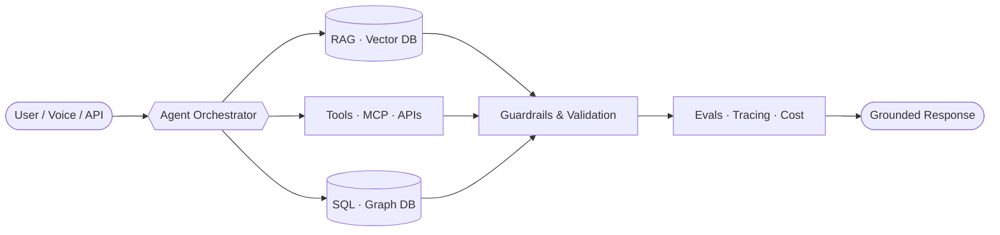

<!-- ═══════════════ HEADER ═══════════════ -->
<p align="center">
  
</p>

<p align="center">
  <a href="https://git.io/typing-svg">
    
  </a>
</p>

<p align="center">
  <a href="https://www.linkedin.com/in/koushik-vardhan-bandi-3343a7307"></a>
  <a href="mailto:bandikoushik781@gmail.com"></a>
  <a href="YOUR_LEETCODE_URL"></a>
</p>

---

## 🧠 `whoami`

```python
class AIEngineer:
    name    = "Koushik Vardhan Bandi"
    focus   = ["Agentic AI", "RAG", "Voice AI", "LLMOps", "Applied ML"]
    stack   = "Python · LangGraph · FastAPI · PyTorch"
    learning = "AI Forward Deployed Engineering 🚀"

    def build(self, problem):
        system = self.design(agents=True, retrieval=True, tools=True)
        system.add(evals=True, guardrails=True, observability=True)
        return system.ship(to="production")

    motto = "If an LLM can get it wrong, put a deterministic check in front of it."
```

---

## ⚡ What I Build

<table>
<tr>
<td width="33%" valign="top">

### 🤖 Agentic Systems
Multi-agent workflows that plan, call tools, and recover from failure. State machines, routing, human-in-the-loop, MCP tool servers.

</td>
<td width="33%" valign="top">

### 📚 RAG & Knowledge AI
Retrieval pipelines over docs, databases and graphs. Chunking, hybrid search, re-ranking, Text-to-SQL, and grounded answers.

</td>
<td width="33%" valign="top">

### 🎙️ Real-time Voice AI
Low-latency voice agents over telephony and WebSockets. Streaming STT/TTS, live LLM APIs, call routing and handoff.

</td>
</tr>
<tr>
<td width="33%" valign="top">

### 🧪 Reliable LLM Apps
Eval harnesses, deterministic validation, guardrails, access control and cost tracking — the parts that make AI trustworthy.

</td>
<td width="33%" valign="top">

### 🔬 Applied ML & DL
Fine-tuning transformers and CNNs for NLP and computer vision, with explainability and experiment tracking.

</td>
<td width="33%" valign="top">

### 🚀 AI Backends
Async APIs, document-intelligence pipelines, containerized services, and the glue that puts models in front of users.

</td>
</tr>
</table>

---

## 🧩 How I Architect AI Systems



**Principles I build by**
- 🎯 **Determinism where it matters** — let the LLM reason, let code do the math and the checks.
- 📏 **Measure, don't vibe** — every system ships with an eval set.
- 🔒 **Safe by default** — read-only access, scoped permissions, timeouts, fallbacks.
- ⚡ **Latency is a feature** — especially when a human is waiting on the other end of a call.

---

## 🌱 Currently Leveling Up: AI Forward Deployed Engineering

Going beyond building models to **deploying AI where the business actually runs**, working directly with real users, inside their data, tools and constraints.

<table>
<tr>
<td width="50%" valign="top">

**🔍 Discovery → Solution**
Turning messy, ambiguous business problems into scoped AI workflows that deliver measurable value.

**🏢 Enterprise Integration**
Plugging LLMs into on-prem databases, CRMs, ERPs and legacy systems, securely.

</td>
<td width="50%" valign="top">

**🧭 Customer-Facing Engineering**
Running demos, gathering feedback, and iterating fast alongside the people who use the system.

**📦 Deploy, Monitor, Improve**
Taking AI from pilot to production, then tracking adoption, accuracy and cost.

</td>
</tr>
</table>

---

## 🛠️ Toolbox

**🤖 LLM & Agents**
<br/>


**🎙️ Voice AI**
<br/>


**🔬 ML & Deep Learning**
<br/>


**🗃️ Data & Vector Stores**
<br/>


**⚙️ Backend, Languages & Tools**
<br/>


---

<p align="center">
  <b>Ask me about:</b> agents, RAG, voice AI, LLM evals. &nbsp;·&nbsp;
  <b>Open to:</b> AI engineering roles & ambitious builds.
</p>

<p align="center">
  
</p>
